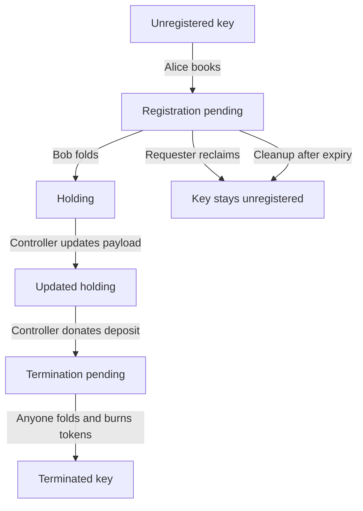

Not for mainnet. Do not deploy Singular or open datum on mainnet until on-chain verification and an independent audit are complete.

# Singular demos

Demonstrations of [Singular](https://github.com/lambdasistemi/singular), a registry of keys on Cardano, with tutorials played on private test chains. A separate recorded journey runs on Cardano preprod. The Singular release used is v0.18.0.

## Demo 1: Carol, Alice and Bob's registry story

Carol creates a registry. Alice registers a key through a booking and a fold, changes its payload, then books its permanent termination and has it folded. Its deposit goes to the treasury. Another request is reclaimed by its requester, and an expired request is cleaned up. Receipts and explorer links show the transactions; they are not an independent read of current state.



A terminated key cannot be registered again. The diagram shows the key's lifecycle; Carol creates the registry before Alice starts.


[The recorded preprod journey](docs/demo1/preprod.md) follows one registry through registration, a direct payload update and permanent termination. It includes the state token, transaction links and the cast.

There are five ways to meet the private-chain tutorial.

**Read a run.** Every command of the tutorial with what it printed in a real run, made by this repository's continuous integration:

https://lambdasistemi.github.io/singular-demo/demo1/run/

**Play it in the browser, on Killercoda.** An Ubuntu machine opens in the browser, with nothing to install, and each command runs with a click. The scenarios are in the course `Singular demos`:

https://killercoda.com/paolino/course/killercoda

The tutorial step by step, as Carol, Alice and Bob beside the chain in four tmux windows: https://killercoda.com/paolino/course/killercoda/demo1-steps

The kit's annotated script, run in one go: https://killercoda.com/paolino/course/killercoda/demo1-script

**Play it in a Codespace.** The same lessons beside a terminal, in your own GitHub Codespace (it uses your own Codespaces quota):

https://codespaces.new/lambdasistemi/singular-demo?quickstart=1

**Play it in your own terminal, on Linux.** The same tutorial step by step, as Alice and as Bob in tmux windows on your own machine: download the kit, put its `bin/` on `PATH` and run `tutorial-stepper play share/tutorials/demo1` (see [On your own machine](#on-your-own-machine)). No account and nothing to install; it needs a 64-bit Linux on x86_64.

The documentation site, with the tutorial, the runs and the annotated script as it ran, is https://lambdasistemi.github.io/singular-demo/

Pay-by-name belongs to a later milestone.

## On your own machine

**With Nix**, one command opens a shell with `singular`, `open-datum`, `devnet` and `jq`, and the tutorial's steps can be pasted into it:

```bash
nix develop github:lambdasistemi/singular-demo --accept-flake-config
```

**Without Nix**, on Ubuntu 24.04 (x86_64): a kit with the same programs, their libraries, the devnet's node and an annotated script of the whole journey. It needs no Nix, no Docker and no root, and installs nothing outside its folder.

```bash
release=v0.18.0-1
curl -fLO https://github.com/lambdasistemi/singular-demo/releases/download/$release/singular-demo-$release-x86_64-linux.tar.gz
curl -fLO https://github.com/lambdasistemi/singular-demo/releases/download/$release/SHA256SUMS
sha256sum -c SHA256SUMS
tar xzf singular-demo-$release-x86_64-linux.tar.gz
cd singular-demo-$release-x86_64-linux
./demo.sh
```

**On a Mac**, with Homebrew: a formula with the same programs and the tutorial, played the same way with tutorial-stepper's terminal face.

```bash
brew tap lambdasistemi/tap
brew trust lambdasistemi/tap
brew install lambdasistemi/tap/singular-demo
singular-demo                  # Demo 1, as Carol, Alice and Bob
```

The trust step lets Homebrew load the tap's other formulas that `singular-demo` depends on.

The runs are kept in `~/demo1-run`. Further arguments go to `tutorial-stepper play`, for example `--run DIR`; a leading `--auto` with `--path short --run-setup --transcript FILE` plays unattended.

`./demo.sh` plays the same 16-step tutorial unattended, with a private devnet and separate actor folders. Its transcript and receipts remain under `WORK`. Use a fresh folder for each chain.

- `WORK=/some/folder ./demo.sh` chooses where vaults, receipts and bundles are kept.
- `PROCESS_TIME_MS=60000 RETRACT_TIME_MS=30000 ./demo.sh` shortens the registry's two windows, and the waits with them.

**The tutorials step by step in your terminal, with tutorial-stepper.** In the same folder, the page beside the window of the person who acts (Alice's, Bob's or the chain's), in tmux. Enter runs the next command in that window and waits until it is over; `s` skips a command, `c` sends it Ctrl-C, `n` and `p` turn the page, `q` closes the page and keeps the windows. The kit brings tutorial-stepper and its own tmux, and a terminal about 160 columns wide fits both. Run again, it goes back to the same windows and page. It takes about 15 minutes.

```bash
export PATH="$PWD/bin:$PATH"
tutorial-stepper play share/tutorials/demo1
```

`--path short` plays Demo 1 with the shortest windows (60 s and 30 s), so the two waits last less:

```bash
tutorial-stepper play --auto share/tutorials/demo1 --path short --run ./demo1-run --run-setup --transcript ./transcript.toml
```

The daily kit, built from `main` every day, always has it:

```bash
release=v0.18.0-1
base=https://github.com/lambdasistemi/singular-demo/releases/download/daily
curl -fLO $base/singular-demo-$release-x86_64-linux.tar.gz
curl -fLO $base/SHA256SUMS
sha256sum -c SHA256SUMS
tar xzf singular-demo-$release-x86_64-linux.tar.gz
cd singular-demo-$release-x86_64-linux
export PATH="$PWD/bin:$PATH"
tutorial-stepper play share/tutorials/demo1
```

## What the repository delivers, and how it is checked

| What | Where it comes from | What checks it |
|---|---|---|
| The Ubuntu kit, a release for each Singular version and kit revision | `nix build .#kit` from `flake.lock`; a pushed tag `vX.Y.Z-N` (the Singular release and `kit/revision`) publishes it | the build, `kit-verify`, `demo.sh` in a clean Ubuntu container with no Nix and no network, and failing controls; the stepper playing Demo 1's shortest path, in a clean Ubuntu container with no tmux, no node, no Nix and no network |
| The tutorial and the runs | `demos/demo1/s*.md`, played by `tutorial-stepper play --auto` against a fresh devnet | the receipts of all 16 steps; the transcript of the run becomes the page `run` |
| The Killercoda scenarios | generated into `killercoda/` by `bash tools/generate.sh .` | the generated files must equal the committed ones, and a scenario test plays them in a clean Ubuntu with real tmux windows |
| The Codespaces tutorial | `.devcontainer/` and `tutorial/`; it plays the same scenario | its own tests, in a browser, up to the whole demo through the buttons |
| The documentation site | `mkdocs.yml`, `docs/`, built by `docs/build.sh` | the site is built from the logs of the same run |

Killercoda and Codespaces run the same scripts of the play, in `demos/demo1/play/`: install the kit, make the folders, set up the shell, start the windows.

A new demo is a folder `demos/demoN/` beside `demo1`, with its steps, its generator and its tests, and a page in `docs/`.

## Working on this repository

```bash
nix develop .#dev --command just ci
```

`just ci` formats nothing and changes nothing: it checks the formatting of every file we write (`nixfmt`, `shfmt`, `biome`, `ruff`), lints them (`shellcheck`, `biome`, `ruff`, `actionlint`), checks that the committed Killercoda scenarios are the ones the step files generate and that this README names the pinned Singular version, and builds the flake checks. `just format` fixes the formatting; `just generate` regenerates the scenarios. The tutorial is edited only in `demos/demo1/s*.md` and its generators, never in `killercoda/`.

When Singular publishes a release, `just bump vX.Y.Z` moves this repository to it: it rewrites the version in the flake, this README and the kit's script, starts the kit's revision again at 1, updates the pinned Singular inputs, regenerates the scenarios and runs the checks. Review the diff, open a pull request, and once it is merged push the tag `vX.Y.Z-1`; the release workflow builds, proves and publishes the kit.

The kit's release is the Singular release and the kit's revision, as in `v0.18.0-1`. The revision is the number in `kit/revision`, the one place it is written: the kit's folder and tarball, the address the installer downloads from, the pages and the release checks take their names from it. A change to the kit under the same Singular release raises it by hand, and `just lint` checks that this README and the kit's readme name the release that results.

A pull request runs, on the self-hosted `nixos` runners after a Build Gate, the flake checks, the kit build and its checks, and the tutorial with `tutorial-stepper play --auto` against a fresh devnet, and the documentation build. It runs on a GitHub-hosted Ubuntu the five jobs that need a real Ubuntu with Docker: the kit in a clean container with no Nix and no network, the two Killercoda scenarios of Demo 1, the kit's stepper play of both tutorials and the Codespaces tutorial. One more job runs on a GitHub-hosted macOS runner: it installs `singular-demo` from a temporary local tap built from the pull request and plays Demo 1's shortest path unattended. On a pull request every whole run uses the least windows the registry allows (60 s and 30 s), so the waits on the chain stay short; main, the nightly run and a release keep the windows the tutorial writes, and their logs are the ones published. A push to main publishes the daily release and the site; a tag `vX.Y.Z-N`, which must name the pinned Singular release and the kit's revision, publishes the numbered release. Commits follow Conventional Commits and pull requests use the template in `.github/`.

## Binary caches

The programs are built by the project's CI and stored in a public Cachix cache. The flake names its caches in `nixConfig`:

- https://paolino.cachix.org
- https://cache.iog.io

Measured from an empty store with only `cache.nixos.org` configured:

| | derivations built | paths fetched | download |
|---|---|---|---|
| flake caches accepted | 1 (the shell itself) | 144 | 190 MiB |
| flake caches not accepted | 1110 | 710 | 1080 MiB |

Without the caches nix compiles the Haskell stack on the machine. Accept the flake configuration, as in the command above.

On a multi-user nix install a user that is not in `trusted-users` cannot add substituters from a flake, even with `--accept-flake-config`. Then either add the user to `trusted-users` in `/etc/nix/nix.conf`, or list the two caches under `trusted-substituters` and accept the flake configuration.

## Limits

- The nix shell is `x86_64-linux` only. Other systems are not built or tested.
- The kit is Ubuntu 24.04 on x86_64. Other distributions and ARM are not tested.
- The kit was run in a clean `ubuntu:24.04` container with no `/nix`, and a kit with one library removed fails, as it should. It was not independently audited.
