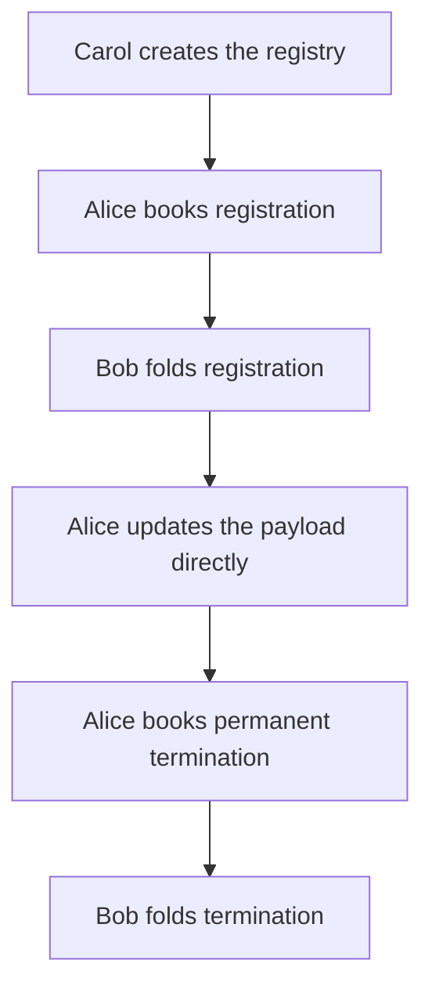

# A registry journey on preprod

This recording was made with Singular v0.17.0, before the key read commands of v0.18.0.

On 28 October 2026, Carol created one registry on Cardano preprod. Alice registered the key `alice`, changed its payload from `{"answer":42}` to `{"answer":43}`, then permanently terminated it. Bob folded the registration and termination. The termination booking donated the protected deposit of 3 ada to the treasury.



The payload update spends the holding directly and needs no fold. A terminated key cannot be registered again.

## Watch the recorded run

<div id="preprod-recording" data-recording="../../assets/video/preprod-v0.17.0.cast" data-markers="[[0.062464,&quot;Create the registry: Carol&quot;],[319.074999,&quot;Resume the same registry&quot;],[323.86014,&quot;Book a registration: Alice&quot;],[351.769202,&quot;Fold the registration: Bob&quot;],[387.373568,&quot;Update the holding directly: Alice&quot;],[411.064877,&quot;Book permanent termination: Alice&quot;],[489.22555,&quot;Fold the permanent termination: Bob&quot;],[532.487827,&quot;Registry journey complete on preprod&quot;]]"></div>

[Download the cast](../assets/video/preprod-v0.17.0.cast). It uses a 110-column, 34-row terminal. The timeline markers jump between the commands; the recording retains the real waits.

The recording pauses after creation to correct the recorder’s receipt checker. The same registry then continues, without repeating a transaction. Complete receipts remained private; the recording shows the transaction ids.

## The released program

The run used the downloaded [Singular v0.17.0 Linux archive](https://github.com/lambdasistemi/singular/releases/download/v0.17.0/singular-0.17.0-x86_64-linux.tar.gz), checked against the release’s [SHA256SUMS](https://github.com/lambdasistemi/singular/releases/download/v0.17.0/SHA256SUMS). Its version output names [the released commit](https://github.com/lambdasistemi/singular/commit/deb4b5c996af40371a97f2d7561aa045ccb3d78e).

The archive’s SHA256 is:

```text
c7d3ffbd47d0cb38728e96acb7dded085ac42b67e682ba31ba24f53a4c6ac4a2
```

## Registry identity

The state token identifies this registry:

```text
499291dbc77fb84b590e4f2d728788aa06191627a2c5c95b6bc4d679.9e77ecf9eb5753111d769ffe7ef7b7c4576cf3345b6ed3d938f5b8117d920038
```

## Transactions

The six commands produced 8 transactions: creation first published two reference scripts. Each command reported success, with its transactions included and observed through its provider.

| Action | Actor | Transaction on preprod |
|---|---|---|
| Publish the registry reference script | Carol | [`975c3785e88965ec1dae8f3e5828a1b0974c3403895581e21e8aabc61018c752`](https://preprod.cardanoscan.io/transaction/975c3785e88965ec1dae8f3e5828a1b0974c3403895581e21e8aabc61018c752) |
| Publish the application reference script | Carol | [`f7de6e31b6b764802e496bd121a7630ee5a2e880f479c6183607233121f155b4`](https://preprod.cardanoscan.io/transaction/f7de6e31b6b764802e496bd121a7630ee5a2e880f479c6183607233121f155b4) |
| Create the registry | Carol | [`45cc0b3bd8ab9e439e2177109c91789a9ac697f2bf71f432eae7ca830ce22672`](https://preprod.cardanoscan.io/transaction/45cc0b3bd8ab9e439e2177109c91789a9ac697f2bf71f432eae7ca830ce22672) |
| Book Alice’s registration | Alice | [`194f4d8c1b37fc839e89d3301166fcae2197d61291782a6e550220a2e9d34b7a`](https://preprod.cardanoscan.io/transaction/194f4d8c1b37fc839e89d3301166fcae2197d61291782a6e550220a2e9d34b7a) |
| Fold the registration | Bob | [`e16eb161094a2aae2d6fc6b129e5ec1615a2e05db3c04c948f37e18b4fcc2dcf`](https://preprod.cardanoscan.io/transaction/e16eb161094a2aae2d6fc6b129e5ec1615a2e05db3c04c948f37e18b4fcc2dcf) |
| Update Alice’s payload | Alice | [`87f2ca318f2d7f94a88c415440378dbe1bc9d6f907c0a2bde7946fa63a53a8a0`](https://preprod.cardanoscan.io/transaction/87f2ca318f2d7f94a88c415440378dbe1bc9d6f907c0a2bde7946fa63a53a8a0) |
| Book permanent termination | Alice | [`cf607a3f794c3faf3321761c6d1d8fb65ad2fae68774a6bc67571747cb8574f6`](https://preprod.cardanoscan.io/transaction/cf607a3f794c3faf3321761c6d1d8fb65ad2fae68774a6bc67571747cb8574f6) |
| Fold the termination | Bob | [`57c6246c9ac9f4300c0a41ecc589e31e89262ab3e7feeb3afda82984b0399549`](https://preprod.cardanoscan.io/transaction/57c6246c9ac9f4300c0a41ecc589e31e89262ab3e7feeb3afda82984b0399549) |

## What the receipts establish

Receipts report the transactions the commands submitted and observed. They are not an independent read of the key’s current state. v0.17.0 had no key read command.

The trie library's proofs are assumed sound.
